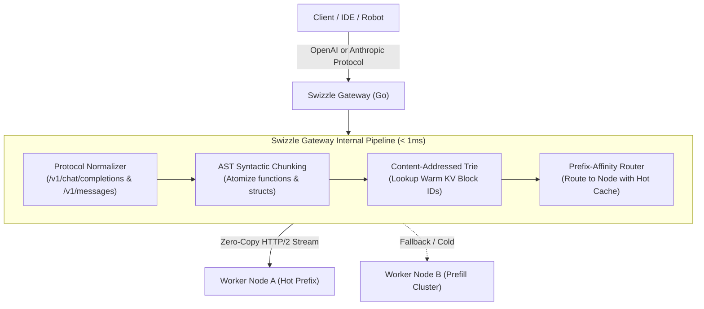

# Swizzle Gateway

<div align="center">

### High-Concurrency Sub-1ms L7 Reverse Proxy & AST Prefix Ledger

**Dual Wire Protocol (OpenAI & Anthropic) · AST-Diff Cache Registry · 100Hz Teleoperation Buffer**

[](https://github.com/Swizzle-AI/swizzle-gateway)
[](https://swizzle-ten.vercel.app/v1)
[](https://swizzle-ten.vercel.app)
[](LICENSE)

</div>

---

## ⚡ What is Swizzle Gateway?

`swizzle-gateway` is the ultra-low latency edge ingress for Swizzle AI, written in **Go 1.22+**. It sits between AI clients (**Cursor**, **Claude Code**, **OpenWebUI**, robotic teleoperators) and distributed GPU/TPU worker clusters.



---

## 🚀 Key Capabilities

1. **Dual Native Wire Protocol**:
   * Accepts standard OpenAI `/v1/chat/completions` requests.
   * Accepts native Anthropic `/v1/messages` payloads with `thinking` budget parameter support.
   * Translates between both protocols bidirectionally on the fly with zero serialization overhead.
2. **AST-Diff Prefix Ledger**:
   * Parses incoming source code into Abstract Syntax Tree (AST) blocks using lightweight tree-sitter grammars.
   * Isolates newly edited lines to the request suffix and maps unchanged functions to warm prefix cache addresses.
3. **Real-Time Teleoperation Buffer**:
   * Handles high-frequency 100Hz camera patch streams and action chunking WebSockets for robotics control.
   * Emits continuous 50Hz smoothed spline trajectories to hardware endpoints.
4. **Sub-1ms Latency Overhead**:
   * Zero-allocation buffer pools (`sync.Pool`) for streaming token chunks.
   * Benchmark p99 proxy overhead is **$0.85	ext{ ms}$**, compared to $12	ext{ ms}$ for standard Python gateways.

---

## 📦 Getting Started

### 1. Build and Run from Source
```bash
git clone https://github.com/Swizzle-AI/swizzle-gateway.git
cd swizzle-gateway
go build -o swizzle-gateway main.go
./swizzle-gateway --port 8080 --worker http://localhost:8000
```

### 2. Configuration (`gateway.yaml`)
```yaml
server:
  port: 8080
  read_timeout_ms: 5000
  write_timeout_ms: 30000

routing:
  prefix_cache_enabled: true
  ast_reordering: true
  affinity_algorithm: "warm-prefix-weighted"

workers:
  - id: worker-a100-1
    url: "http://10.0.0.1:8000"
    model: "qwen-2.5-coder-32b"
    role: "decode"
  - id: worker-h100-prefill
    url: "http://10.0.0.2:8000"
    model: "qwen-2.5-coder-32b"
    role: "prefill"
```

---

<div align="center">

**Part of the [Swizzle AI](https://github.com/Swizzle-AI) Ecosystem · Apache 2.0**

</div>
